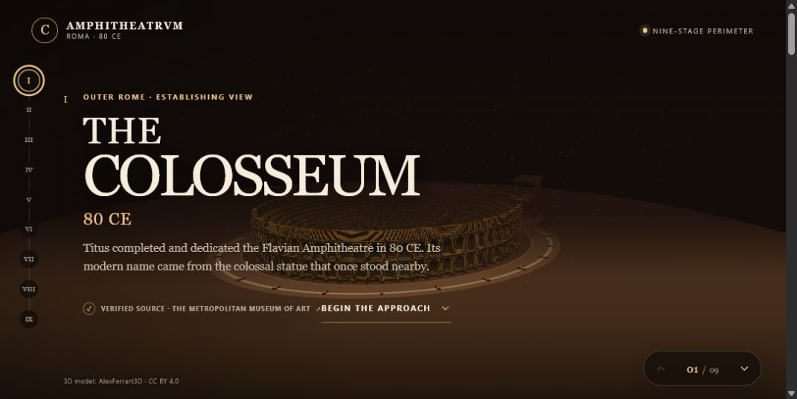
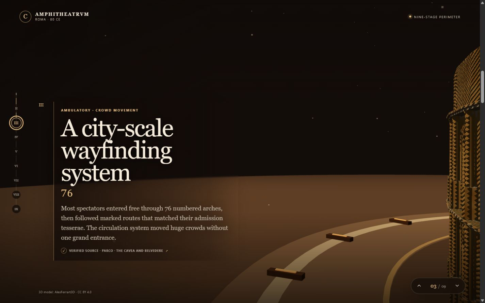
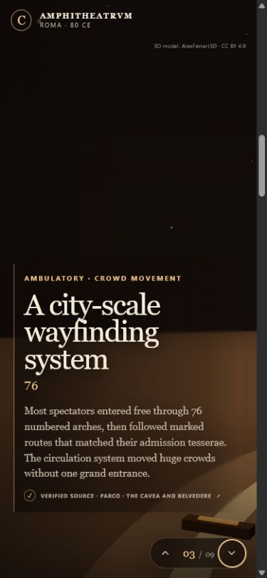
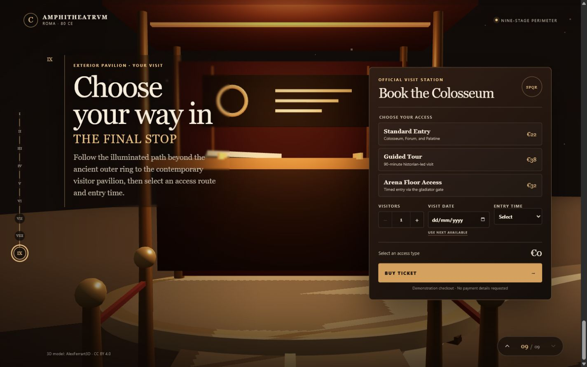
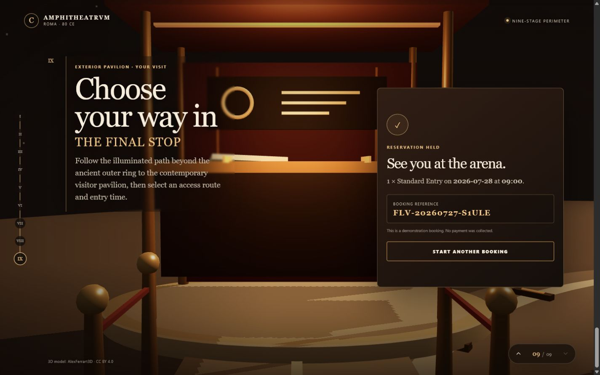
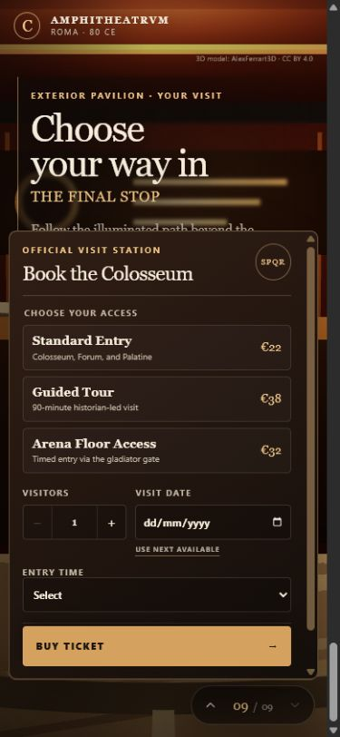

# Visual Validation

These captures were produced from the running Vite application with the
in-app browser after the camera, perimeter, pavilion, and responsive layout
were corrected and revalidated.

## Imported model

The selected GLB was inspected in the rendered application, not accepted from
metadata alone. The capture confirms that it reads as a complete, multi-level
Roman amphitheatre with an oval plan, repeated exterior arches, inner seating,
and an open arena.

## Ground-level perimeter

The camera is near human eye height after the approach. Its position is
derived from the same measured, model-aligned ellipse that renders the
walkway, so both staged stops and animated transitions remain outside the
imported structure.

## Ticket destination and flow

The contemporary pavilion sits beyond the ancient outer ring with its
customer-facing side aimed at the arriving camera. Desktop, short-laptop, and
390 × 844 mobile checks verify that the ticket interface is reachable,
readable, and integrated with the final camera composition. The complete
demonstration booking flow was also exercised through its confirmation state.
